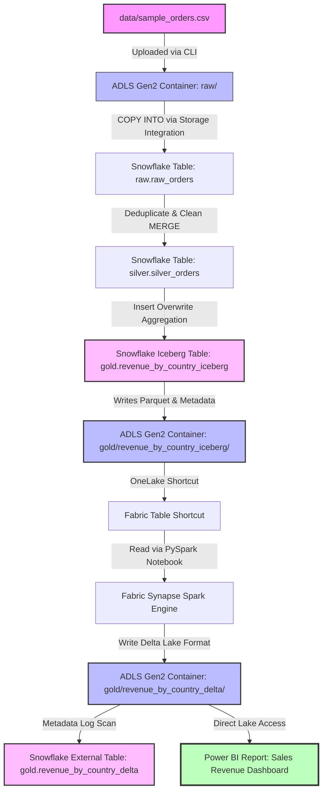

# Architectural Blueprint

This document details the data flow, security model, and format conversion patterns implemented in the **Snowflake ↔ Microsoft Fabric Open Table Format Interoperability** project.

---

## 📐 Data Flow Architecture

The following diagram illustrates how transaction data is ingested, refined, formatted, and shared bi-directionally across Snowflake and Microsoft Fabric:

---

## 🔒 Security and Access Control Model

A key pillar of this architecture is **secure delegated access** without hardcoded keys:
- **Snowflake to ADLS Gen2**: Snowflake uses a multi-tenant application registration in Entra ID. We retrieve the application name and consent to it in the customer's tenant, granting it the **Storage Blob Data Contributor** role on the storage account.
- **Fabric Spark to ADLS Gen2**: Fabric Spark notebooks authenticate using an Entra ID **Service Principal**. The Service Principal is granted **Storage Blob Data Contributor** role restricted specifically to the ADLS Gen2 Container level (least privilege principle).
- **Column-Level Governance**: In Snowflake, a dynamic **Masking Policy** is applied to the `email` column, restricting unprivileged roles (like `PUBLIC` or `analyst_role`) from viewing raw customer PII.

---

## 📂 Format Translation & Interoperability

This project highlights how data sharing is achieved using open table metadata standards:

### Apache Iceberg Format (Snowflake-Managed)
- Snowflake acts as the Iceberg Catalog.
- When Snowflake writes data, it outputs standard Apache Parquet data files alongside a `metadata/` directory containing Iceberg metadata (snapshots, manifests, and manifest lists).
- Microsoft Fabric reads this directly because its Spark engine parses the Iceberg metadata folders via OneLake ADLS Gen2 shortcuts.

### Delta Lake Format (Fabric-Managed)
- Microsoft Fabric Spark writes standard Apache Parquet data files alongside a `_delta_log/` transaction directory (JSON commits).
- Snowflake reads this data by specifying `TABLE_FORMAT = DELTA`. When we run a `REFRESH`, Snowflake scans the transaction log (`_delta_log/*.json`) to instantly detect new parquet files and drop obsolete ones, providing ACID-compliant snapshot isolation queries.
